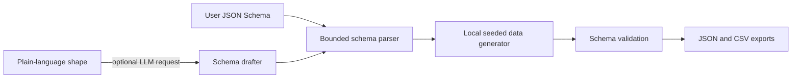

# Architecture

## Generation flow

## Design decisions

- **Schema-first:** fields, types, and common constraints are explicit and reviewable.
- **Synthetic-only values:** generated contact details use reserved example domains and fictional patterns; no production data is loaded.
- **Repeatability:** a local random generator and seed make random values reproducible.
- **Scenario coverage:** output includes positive, boundary, and intentionally invalid records with expected validation behavior.
- **Optional AI assistance:** the LLM drafts a bounded schema from a user description. The generated rows are created locally.
- **Bounded input:** `$ref`, oversized schemas, and unsupported schema features are rejected in this demo.

## Production evolution

Add support for the full JSON Schema specification, domain-specific constraints, locale-aware synthetic data, referential integrity across datasets, secure secret handling in test environments, and connectors to isolated test fixtures. Keep production-data import out of scope unless a separately reviewed anonymization workflow is introduced.

